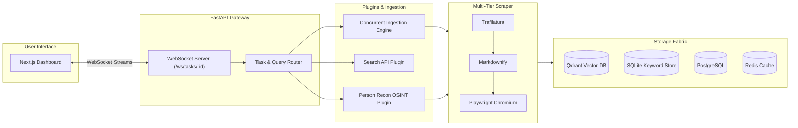

# Craw-In (InfoOS Core)

> High-performance, AI-assisted web intelligence, OSINT footprinting, and deep-crawling platform.

Craw-In integrates resilient multi-tiered web scraping, targeted entity disambiguation, hybrid vector-and-keyword indexing, and real-time streaming telemetry into a unified analyst dashboard.

---

## Architecture Overview



---

## Key Features

### 1. Multi-Tiered Content Ingestion
- **Tier 1 (Fast DOM Parser):** Uses `trafilatura` for clean, article-first markdown extraction.
- **Tier 2 (Structural Markdown):** Falls back to `markdownify` when parsed text is sparse.
- **Tier 3 (Headless Browser):** Automatically spins up headless **Playwright Chromium** to execute client-side JavaScript for dynamic single-page applications.

### 2. 360° OSINT & Entity Reconnaissance
- **Target Extraction:** Parses target names and context anchors (company, location, role, education).
- **Cross-Platform Footprinting:** Queries a specialized SERP matrix covering LinkedIn, GitHub, X (Twitter), Google Scholar, News outlets, and Corporate Registries (Crunchbase/Bloomberg).
- **Disambiguation Engine:** Uses strict name grounding and anchor-weighted scoring to filter out noise and false positives.
- **Automated Deep Scraping:** Deep-crawls top-ranked profile matches and produces structured intelligence dossiers.

### 3. Resilient Live Web Search
- Integrates the **Jina AI SERP API** for LLM-friendly search output.
- Features automatic, keyless fallback to **DuckDuckGo HTML** scraping to ensure zero disruption.
- In-memory **TTL caching** minimizes redundant external queries.

### 4. Hybrid Storage & Indexing Fabric
- **Semantic Vector Store:** Embeds scraped content using local `FastEmbed` (`all-MiniLM-L6-v2`) and indexes embeddings into **Qdrant**.
- **Keyword Store:** Full-text keyword document persistence powered by **SQLite** and SQLAlchemy.

### 5. Multi-Provider LLM Integration
- Flexible runtime routing supporting:
  - **Local Ollama** (e.g., `qwen2.5:7b`)
  - **OpenAI** (`gpt-4o`, `gpt-4-turbo`)
  - **Anthropic** (`claude-3-5-sonnet`)
  - **DeepSeek** (`deepseek-chat`)

### 6. Interactive Intelligence Dashboard
- Built with **Next.js 15**, **Tailwind CSS**, and **Lucide Icons**.
- Real-time task telemetry streaming via WebSockets.
- Interactive terminal logs, model configuration switcher, and split-screen document preview panel.

---

## Tech Stack

| Layer | Technologies |
| :--- | :--- |
| **Backend** | Python 3.11+, FastAPI, Uvicorn, WebSockets, HTTPX, Pydantic v2 |
| **Scraping** | Trafilatura, Markdownify, Playwright (Chromium), BeautifulSoup4 |
| **Storage & Embeddings** | Qdrant, FastEmbed (MiniLM-L6-v2), SQLAlchemy, SQLite, PostgreSQL |
| **Distributed / Cache**| Redis, Celery |
| **Frontend** | Next.js 15 (App Router), TypeScript, Tailwind CSS, Radix UI |
| **Infrastructure** | Docker, Docker Compose |

---

## Developer Notes: How to Run Locally

### Prerequisites
- **Python:** `3.11` or higher
- **Node.js:** `18.x` or higher (or Bun)
- **Docker & Docker Compose:** Installed and running

---

### Option A: Complete Docker Compose Stack (Recommended)

Run the entire platform (Postgres, Redis, Qdrant, Backend, and Frontend) in Docker:

```bash
# 1. Clone the repository and navigate to root
git clone <repo-url>
cd Craw-In

# 2. Configure environment variables
cp .env\ example .env
# Edit .env and supply your JINA_API_KEY (optional, fallback available)

# 3. Build and launch all services
docker compose -f docker-compose.prod.yml up --build -d

# 4. View logs
docker compose -f docker-compose.prod.yml logs -f
```

- **Frontend:** [http://localhost:3000](http://localhost:3000)
- **Backend API:** [http://localhost:8000](http://localhost:8000)
- **Qdrant Dashboard:** [http://localhost:6333/dashboard](http://localhost:6333/dashboard)

To shut down containers and clean volumes:
```bash
docker compose -f docker-compose.prod.yml down -v
```

---

### Option B: Local Manual Setup (Development Mode)

#### 1. Start Support Infrastructure
Start only the required databases (Qdrant, Redis, Postgres):
```bash
docker compose up -d qdrant redis postgres
```

#### 2. Configure Environment Variables
Create a root `.env` file:
```bash
cp .env\ example .env
```
Ensure your `.env` contains:
```env
QDRANT_HOST=localhost
QDRANT_PORT=6333
REDIS_HOST=localhost
REDIS_PORT=6379
OLLAMA_ENDPOINT=http://localhost:11434
JINA_API_KEY=your_optional_jina_key
```

#### 3. Setup and Run Backend
```bash
# Create and activate virtual environment
python3 -m venv .venv
source .venv/bin/activate

# Install Python dependencies
pip install --upgrade pip
pip install -r requirements.txt

# Install Playwright browser binaries and OS dependencies
playwright install --with-deps chromium

# Launch FastAPI development server
uvicorn main:app --reload --host 0.0.0.0 --port 8000
```
*The backend will be live at `http://localhost:8000` with WebSocket endpoint at `ws://localhost:8000/ws/tasks/{task_id}`.*

#### 4. Setup and Run Frontend
In a new terminal window:
```bash
cd workspace

# Configure WebSocket target
echo "NEXT_PUBLIC_WS_URL=ws://localhost:8000/ws/tasks" > .env.local

# Install dependencies
npm install
# or: bun install

# Start Next.js development server
npm run dev
# or: bun dev
```
*The dashboard will be live at `http://localhost:3000`.*

---

## Configuration Reference

| Variable | Default | Description |
| :--- | :--- | :--- |
| `NEXT_PUBLIC_WS_URL` | `ws://localhost:8000/ws/tasks` | WebSocket endpoint consumed by the UI dashboard |
| `QDRANT_HOST` | `localhost` | Hostname for the Qdrant vector database |
| `QDRANT_PORT` | `6333` | REST port for Qdrant |
| `REDIS_HOST` | `localhost` | Redis caching and broker host |
| `REDIS_PORT` | `6379` | Redis port |
| `OLLAMA_ENDPOINT` | `http://localhost:11434` | Local Ollama instance URL |
| `JINA_API_KEY` | *(optional)* | API key for Jina SERP search (DDG fallback used if absent) |
| `PLAYWRIGHT_TIMEOUT` | `20` | Maximum wait duration (seconds) for browser network idle |
| `PLAYWRIGHT_CONCURRENCY`| `3` | Maximum simultaneous headless browser instances |

---

## Testing

To run backend integration tests:
```bash
# Ensure virtual environment is active
PYTHONPATH=. pytest -v tests/
```